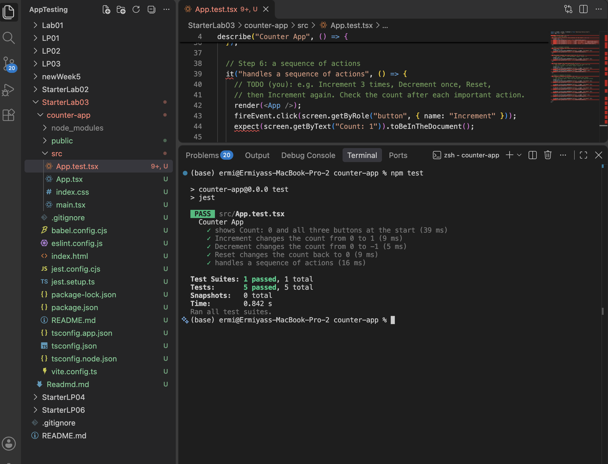
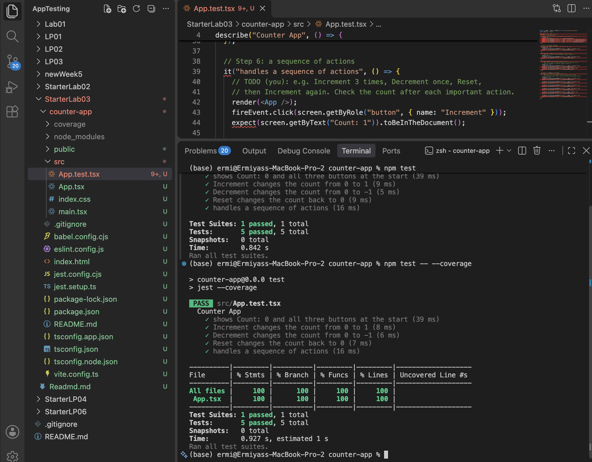

# Lab: Exploratory and White Box Testing

Application tested: `counter-app` (React + TypeScript)

## Step 1: Exploratory Testing

**Charter:** Explore the Increment, Decrement, and Reset buttons by clicking them alone and in different sequences, to discover whether the displayed count always changes as expected.

| Action | Expected Result | Actual Result | Pass or Fail |
| ------ | --------------- | ------------- | ------------ |
| Select Increment once | The count increases by one (Count: 1) | Count: 1 | Pass |
| Select Decrement once (from Count: 1) | The count decreases by one (Count: 0) | Count: 0 | Pass |
| Select Increment 5 times in a row (from 0) | Count: 5 | Count: 5 | Pass |
| Select Reset when the count was 5 | Count: 0 | Count: 0 | Pass |
| Select Increment after Reset | Count: 1 | Count: 1 | Pass |
| Select Decrement many times | The count keeps decreasing with no limit | Reached -68, then -203, with no sign of a limit | Pass |

**Observation:** The count can go negative with no lower limit. This matched my expectation, but a real counter might want a minimum value.

## Step 2: Examine the Source Code

- **Starting value of `count`:** `0`, set by `useState(0)`.
- **Statements that change `count`:**
  - `setCount(count + 1)` runs when the user clicks **Increment**.
  - `setCount(count - 1)` runs when the user clicks **Decrement**.
  - `setCount(0)` runs when the user clicks **Reset**.
- **Branches or loops:** None. The component has no `if`, ternary, `&&`, `for`, or `while`.
- **Does branch or loop coverage apply?** No. A branch is a place where the code chooses between paths, and a loop repeats code. The component has neither. Increment and Decrement are two separate buttons that each run one statement, so there is no decision in the code. **Statement coverage** (and function coverage) are the measures that apply here.

## Step 3: Create the Test File

The tests are in `src/App.test.tsx`. They use `render` and `screen` from React Testing Library, `fireEvent` to click the buttons, and Jest assertions (`expect`) to check the displayed count. All tests are inside one `describe("Counter App", ...)` block.

## Step 4: Test the Starting State

The test "shows Count: 0 and all three buttons at the start" confirms that the component displays `Count: 0` and that the Increment, Decrement, and Reset buttons appear.

## Step 5: Test Statement Coverage

- **Increment:** the count changes from `0` to `1`.
- **Decrement:** the count changes from `0` to `-1`.
- **Reset:** the test first clicks Increment so the count is `1`, then clicks Reset and checks that the count returns to `0`.

## Step 6: Test a Sequence of Actions

The test "handles a sequence of actions" does this in order, checking the count after each step:
Increment (1) → Increment (2) → Increment (3) → Decrement (2) → Reset (0) → Increment (1).

## Step 7: Run the Tests

```bash
npm test
```

Result: 1 test suite passed, 5 tests passed.



## Step 8: Code Coverage

```bash
npm test -- --coverage
```

| Coverage Type | Percentage |
| ------------- | ---------- |
| Statements    | 100        |
| Branches      | 100        |
| Functions     | 100        |
| Lines         | 100        |



- **Which parts of the component did the tests execute?** The tests rendered the component (including the initial `useState(0)`) and clicked all three buttons, so all three click handlers ran: `count + 1`, `count - 1`, and `setCount(0)`.
- **Were any statements untested?** No. The "Uncovered Line #s" column is empty, so every statement was executed.
- **Why does the component report few or no branches?** The component has no `if` statements, ternaries, or other decision points, so there are zero branches to cover. When there is nothing to cover, the tool reports 100%.
- **Does the percentage alone prove the component works correctly?** No. Coverage only shows which code ran, not whether the results were correct. A test with no `expect` could still produce 100% coverage. The component is only shown to work because the tests also check the displayed count after each action. Coverage also says nothing about cases I did not test, such as very large or very small counts.

## Step 9: Compare the Two Approaches

- **Idea from exploratory testing:** While clicking Decrement many times, I discovered that the count can keep going negative with no lower limit (I reached -203). I would not have thought to check how far down it goes from the code alone.
- **Idea from reading the source code:** The code showed that the component has no branches or loops, so branch and loop coverage do not apply. It also showed that each button runs exactly one statement, which told me exactly which three statements my tests needed to cover.
- **How viewing the code changed my testing:** Before, I was testing by guessing and clicking. After reading the code, I knew precisely which statements existed, so I could design tests to run each one and measure it with a coverage report. The tests became more complete and repeatable.
- **Limitation of exploratory testing:** It is hard to measure coverage. I cannot be sure I tried everything, and my notes are only as good as what I remember to write down.
- **Limitation of white box testing:** It is based on the code as written. It can show that every statement ran, but it cannot tell me whether the requirements are right, such as whether a counter should be allowed to go negative.

## AI Transparency

AI was used to clean up its writing and formatting.